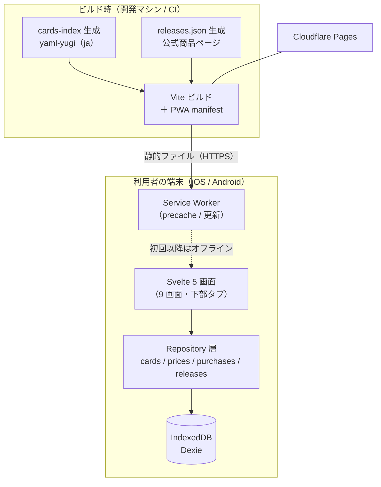
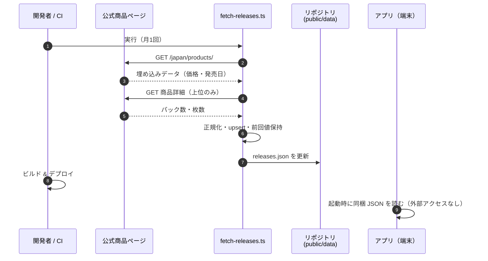

# 1. 結論

| 領域 | 採用 |
| --- | --- |
| 言語 | TypeScript 5.x（strict） |
| UI | Svelte 5（Runes） |
| ビルド | Vite 7 + `@sveltejs/vite-plugin-svelte`（SPA / SSR なし） |
| ルーティング | 自前の軽量ハッシュルーター（30 行程度）。複雑化したら `@tanstack/svelte-router` |
| スタイル | Tailwind CSS 4（`@tailwindcss/vite`） |
| 永続化 | IndexedDB + Dexie 4 |
| バックアップ | `dexie-export-import`（JSON） |
| PWA | `vite-plugin-pwa`（Workbox、precache + 更新プロンプト） |
| アイコン | `lucide-svelte` |
| グラフ | まず CSS バー。必要になったら `layerchart` |
| テスト | Vitest + `@testing-library/svelte` / Playwright（Chromium + WebKit） |
| Lint/Format | ESLint 9（flat config） + Prettier |
| 配信 | Cloudflare Pages（第一候補）/ GitHub Pages（代替） |
| CI | GitHub Actions（型検査・テスト・ビルド） |

# 2. なぜこの構成か

## Svelte 5 + Vite（SSR なし SPA）

- ローカル DB（IndexedDB）が唯一の真実なので、**サーバーサイドレンダリングは不要**。静的ファイルだけで完結する。
- Svelte 5 はランタイムが小さく、中位 Android での起動・操作が軽い。個人用アプリでバンドルサイズは正義。
- 素の SPA 構成なら `base` パスだけ気にすれば GitHub Pages / Cloudflare Pages の両方に出せる。

## ハッシュルーティング

- GitHub Pages は SPA の深いパスで 404 を返す。ハッシュ（`/#/wish`）なら追加設定ゼロ。
- 画面が 9 つ・ネストなしなので、ルーターライブラリは入れない（依存の互換性リスクを避ける）。

## Dexie 4

- IndexedDB の薄いラッパーで、スキーマのバージョン管理（`stores({...}).version(n).upgrade()`）が明快。
- 複合インデックス（`[cardId+storeId+observedAt]` など）と範囲クエリが素直に書ける。
- `dexie-export-import` で JSON のエクスポート/インポートがほぼ 1 関数（R-70 を最短で満たす）。
- 画面から直接触らず **Repository 層**を挟む（将来の同期差し込み点）。

## Tailwind 4

- 画面数 9 の小規模アプリ。デザインシステムを作るより、ユーティリティで速度を優先。
- 片手操作・下部タブ・大きめタップ領域をクラスで統一できる。

## PWA（インストール型）

- iOS/Android 両対応を、ストア審査・ビルド証明書・TestFlight なしで達成。
- オフラインを Workbox の precache で担保。店内の弱電波でも動く。
- 制約は §6 に明記。

# 3. システム構成（C4: Container / Component）

**何を表す図か**: 端末内で完結するアプリと、ビルド時にだけ外部データを取るパイプラインの関係。



**ポイント**

- 実行時は**外部 API を呼ばない**（オフライン要件と規約リスクの回避）
- カード索引・新弾情報は**ビルド成果物**として同梱する

# 4. レイヤ構成

```
src/
  routes/            画面（Svelte コンポーネント）
  lib/
    components/      UI 部品（Card, Sheet, NumberPad, TabBar...）
    stores/          Svelte 5 runes ベースの画面状態
    domain/          型・不変条件・計算（予算、残枚数、最安値、パック換算）
    db/              Dexie スキーマ・マイグレーション
    repositories/    cards / stores / wish / prices / purchases / releases / reminders
    services/        import-export, search-index
    utils/           日付・通貨・正規化
public/
  data/
    cards-index.json    日本語名検索用の軽量索引（ビルド生成）
    cards/<chunk>.json  カード詳細（遅延ロード）
    releases.json       新弾（発売日・定価・パック数）
scripts/
  build-card-index.ts   yaml-yugi → cards-index.json + 詳細チャンク
  fetch-releases.ts     公式商品ページ → releases.json（手動 or CI・月1回）
```

**依存方向**: routes → stores → repositories → db。`domain/` は純粋関数のみ。画面から `db` を直接 import しない。

# 5. データ取り込み

## 5.1 カードマスタ（名前単位）

**入力**: `https://dawnbrandbots.github.io/yaml-yugi/cards.json`（`name.ja` / `text.ja` を確認済み）

**変換**（`scripts/build-card-index.ts`）

1. 全件取得し、`name.ja` を持つカードに絞る
2. 索引: `{ i: konamiId, p: passcode, n: nameJa, nn: nameNorm, e: nameEn, t: cardType }`
3. **セット・型番・レアリティは取り込まない**（再録は同一カードとして統合）
4. `nameNorm` は全角英数→半角、カタカナ→ひらがな、記号除去、空白圧縮

**サイズ方針**: 索引 1 ファイル（数 MB 以内、precache）＋詳細 500〜1000 件/チャンク。画像なし。

## 5.2 新弾（発売日・定価・パック数）

**確認済みの事実**（2026-11-27 実測）

- 商品一覧ページに `p[n] = { title, price-intax: "1パック 198円" / "1ボックス 2,530円", price-extax, release-date, url, ... }` の構造化データが埋め込まれている
- 商品詳細ページに `5枚入り` `30パック入り` の表記がある（例: PRIDE AND SOUL = 1パック198円 / 5枚入り / 30パック入り）

**抽出**（`scripts/fetch-releases.ts`）

1. 一覧ページの埋め込みオブジェクトをパース → `title / kind / price-intax / release-date / url`
2. `price-intax` の接頭辞で単位を判定（`1パック` / `1ボックス`）
3. 詳細ページから `N パック入り` `M 枚入り` を抽出 → `packsPerBox` / `cardsPerPack`
4. 出力 `releases.json`。値が取れない項目は `null`（アプリ側で設定の既定値にフォールバック）
5. 同一 `name + releaseDate` は upsert。**手動修正値は上書きしない**

**何を表す図か**: 月 1 回の取り込みとアプリ配信の流れ。



**失敗時**: 取得に失敗しても既存 `releases.json` を保持し、`importedAt` を更新しない。アプリは手動修正（R-63）で継続できる。

# 6. iOS PWA の制約と対策

| 制約 | 対策 |
| --- | --- |
| ホーム画面追加は Safari の共有メニューから手動 | 初回起動時に追加手順を 1 画面で案内 |
| プッシュ通知は iOS 16.4+ かつ「追加済み」のみ | 通知は C。まずアプリ内リマインダー（R-64） |
| 7 日間未使用でストレージが退避され得る | 起動時に最終エクスポート日を確認し促す（R-71） |
| バックグラウンド同期なし | 同期は起動時のみ。将来もフォアグラウンド同期 |
| ストレージ永続化を保証できない | `navigator.storage.persist()` を要求し、結果を設定画面に表示 |

# 7. テスト方針

- **domain**: 予算・残枚数・最安値・**パック/BOX 換算**・月境界（Asia/Tokyo）を純関数で単体テスト
- **repositories**: `fake-indexeddb` で CRUD とマイグレーション
- **E2E（Playwright）**: 「検索→欲しい→巡回→比較→購入→予算反映」＋「新弾→予約→発売」の 2 本を WebKit / Chromium で
- **実機**: Xperia（Android）でインストール・機内モード・入力速度。iOS は可能な範囲で Safari 実機確認

# 8. 配信

- **Cloudflare Pages**（第一候補）: 無料・HTTPS・プレビュー URL・`_headers` でキャッシュ制御
- **GitHub Pages**（代替）: ハッシュルーティングなので `base` のみ
- ビルド成果物は `dist/`。`npm run build` 一発でデプロイ可能に保つ

# 9. 採用しなかった案

| 案 | 却下理由 |
| --- | --- |
| Flutter | ネイティブの利点（通知・ストア）は魅力だが、配布が PWA で足りるため iOS ビルド環境を持ち込む理由が弱い |
| 型番（セットコード）単位のデータモデル | 再録・イラスト違いを同一カードとして扱う方針に反する。価格はレアリティの任意ラベルで補う |
| React + Vite | 有力。ただし画面数が少なく Svelte の記述量・サイズの利が大きい |
| SvelteKit | SSR・ルーティング規約が不要。静的 SPA で十分 |
| Supabase 直結 | 同期は C。まずローカル完結 |
| localStorage | 容量・トランザクションに不安。IndexedDB 一択 |
| YGOPRODeck API を実行時に呼ぶ | 英語・TCG 中心で OCG 日本語要件を満たさず、オフライン要件にも反する |
