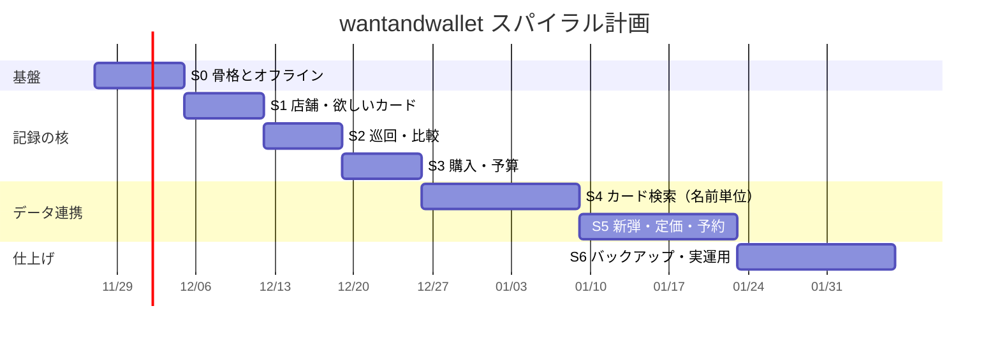
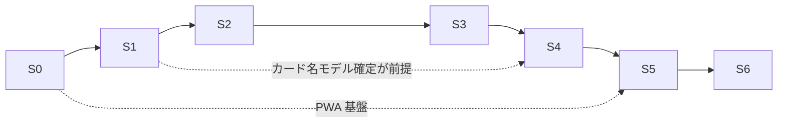

# 1. 方針

- **価値が早く出る順**に積む。最初に「欲しい→比較→購入→予算」を 1 本通す（S1〜S3）。
- 反復は**モックアップ先行のスパイラル**（[06-process.md](06-process.md)）。モック承認なしに実装しない。
- 各スパイラルは**単独で使える状態**（デプロイ済み・実機で操作できる）を完了条件とする。
- カードデータ取り込み（S4）は重いので後回し。S1〜S3 は手入力で成立させる。
- 新弾（S5）は「定価・パック数・予約」に絞る。店舗別の価格比較はしない。

# 2. マイルストーン一覧

| M | 名称 | 対応 S | 成果 |
| --- | --- | --- | --- |
| M0 | 基盤 | S0 | 空のアプリが実機で起動・オフライン動作・CI 緑 |
| M1 | 記録の核 | S1, S2, S3 | 欲しい→巡回→比較→購入が通る |
| M2 | 予算とダッシュボード | S3 | 月次予算・内訳・残額・予約枠 |
| M3 | カードマスタ連携 | S4 | 日本語名検索（名前単位） |
| M4 | 新弾・定価・予約 | S5 | 発売日・定価・パック数・予約・リマインダー |
| M5 | 仕上げ・配布 | S6 | バックアップ、実機検証、公開 URL |

# 3. スケジュール

**何を表す図か**: 2026-11-27 開始時点のスパイラル計画（1 週 = 平日夜＋休日半日）。

# 4. 各スパイラル詳細

## S0 基盤（11/27 – 12/04）

- リポジトリ初期化、Vite + Svelte 5 + TypeScript（strict）、Tailwind 4、PWA、ハッシュルーター
- 9 画面のプレースホルダ、Dexie v1 スキーマ、Repository の空実装
- ESLint / Prettier / Vitest、GitHub Actions（型検査・テスト・ビルド）
- Cloudflare Pages へ初回デプロイ
- **モック v0.1 は提出済み（承認待ち）**

**DoD**

- [ ] スマホで URL を開きホーム画面に追加できる
- [ ] 機内モードで再起動しても画面が出る
- [ ] `check` / `test` / `build` がローカルと CI で緑
- [ ] 9 画面の遷移が実機で引っかからない

## S1 店舗・欲しいカード（12/05 – 12/11）

- 店舗マスタ CRUD（R-20〜R-22）
- 欲しいリスト CRUD（R-10〜R-12, R-14）
- カードの手入力登録（R-03, R-05: 正規化名で一意）
- Repository 層の確立、domain の純関数と単体テスト

**DoD**

- [ ] 手入力したカードで欲しいリストを作れる
- [ ] 同名カードを二重登録できない
- [ ] レアリティが任意項目として保存・表示される

**リスク**: カード名の揺れ（「灰流うらら」/「灰流うらら(別イラスト)」）→ 正規化と別名（かな）で吸収

## S2 巡回・比較（12/12 – 12/18）

- 巡回モード（R-31, R-36〜R-38）: 店舗選択 → 1 枚ずつ価格入力 → 保存して次へ。並び順は「優先度順」と「種類→名前順」を切替
- 比較表（R-32, R-33）: カード単位で店舗別最新価格、最安強調
- 在庫状態（R-34）

**DoD**

- [ ] 3 店舗 × 1 カードの価格を入力し、最安が判別できる
- [ ] 巡回モードで 10 枚の入力が 2 分以内
- [ ] 並び順の切替が 1 タップで効き、種類→名前順がモンスター→エクストラ→魔法→罠になる
- [ ] 店舗チップが最後に訪れた順に並び、右端の「＋」が常に固定される
- [ ] レアリティが違っても 1 カードとして並ぶ（混在時の見せ方を確認）

**リスク**: レアリティ混在で最安比較が誤解を招く → 表示にレアリティを添える（比較はカード単位のまま）

## S3 購入・予算（12/19 – 12/25）

- 購入登録（R-40〜R-42）: 単品/パック/BOX、予約（R-45）、開封加算（R-44）
- 月次予算・カテゴリ配分（R-50〜R-53）、予約枠の別表示（R-57）
- ホームのダッシュボード

**DoD**

- [ ] 受入基準の予算項目（10,000 / 3,200 / 残 6,800 / 32%）を満たす
- [ ] 予約があるとき、残額 = 上限 − 購入 − 予約 になり、グラフが 購入/予約/残り の 3 色で表示される
- [ ] 予約中は支出に計上されず、予約枠として表示される
- [ ] 月境界が Asia/Tokyo で正しく切り替わる

## S4 カード検索（12/26 – 01/08）

- `scripts/build-card-index.ts`: yaml-yugi → 正規化索引（名前単位・セット情報は捨てる）
- 日本語名の部分一致検索（R-01）、欲しいリストへ追加（R-02）
- 再取り込み時の upsert（手入力メモを壊さない）
- 性能測定（1.3 万件、300ms 以内）

**DoD**

- [ ] 「うらら」で灰流うららが上位に出る
- [ ] 再録・別イラストが 1 件に統合される
- [ ] 索引込みの初回ロードが 5MB 以下

**リスク**: 同名の別カード（例: 英語名の揺れ）→ パスコード併記で判別

## S5 新弾・定価・予約（01/09 – 01/22）

- `scripts/fetch-releases.ts`: 一覧の埋め込みデータ（価格・発売日）＋詳細（パック数・枚数）
- 新弾一覧・カウントダウン（R-60, R-61）
- 定価・パック数の表示と手動修正（R-63）、設定の既定パック数（R-82）
- 予約の記録と一覧（R-65）、リマインダー（R-64）

**DoD**

- [ ] 次の新弾が発売日順に並び、パック/BOX 定価とパック数が出る
- [ ] 取り込みを 2 回実行しても重複しない
- [ ] 取得失敗時に既存データが消えない
- [ ] 予約を登録し、発売後に「購入済みにする」へ移せる

**リスク**: 表記ゆれ（`1パック`/`1個`）→ 抽出失敗は null にして手動修正へ誘導

## S6 仕上げ・配布（01/23 – 02/05）

- JSON エクスポート/インポート（R-70, R-71）、全削除（R-84）
- iOS ホーム画面追加の案内、`navigator.storage.persist()`
- Playwright の通しシナリオ（WebKit / Chromium）
- Xperia 実機での操作速度・機内モード確認、1 週間の実運用
- 公開 URL の確定（Cloudflare Pages）

**DoD**

- [ ] 受入基準 9 項目すべてチェック
- [ ] エクスポート→全削除→インポートで完全復元
- [ ] iOS Safari でインストール〜主要操作が破綻しない
- [ ] 自分の買い物で 1 週間運用

# 5. 依存関係

# 6. バックログ（S6 以降 = C 要件）

- 発売日プッシュ通知（iOS 16.4+ / Android）
- 端末間同期（Supabase、Repository 層の裏）
- 価格履歴グラフ（カードごとの推移）
- 予算繰り越し・給料日起点
- バーコード/カード番号のカメラ読み取り
- CSV インポート（既存メモから移行）
- 開封結果の記録（パックごとの当たり管理）
- 画像表示（権利整理が前提）

# 7. 最初のスパイラル S0 の具体タスク

1. [x] L0: 全 9 画面の遷移図とワイヤー（`07-wireframes-s0.md`）
2. [x] L1: `mockups/s0/` の Svelte モック（実機幅・実データ風）
3. [ ] レビュー: 実機で触り、承認を `05-decisions.md` に記録（Q-09〜Q-13）
4. [ ] 実装: `npm create vite@latest . -- --template svelte-ts`、Tailwind 4、PWA、ハッシュルーター、9 画面
5. [ ] Dexie v1 スキーマ＋空の Repository、`monthRange` / `remainingQty` / `effectiveUnitPrice` の単体テスト
6. [ ] CI（typecheck / test / build）、Cloudflare Pages へデプロイ
7. [ ] 実機でホーム画面追加 → 機内モード起動を確認（K-01 の初期判定）
