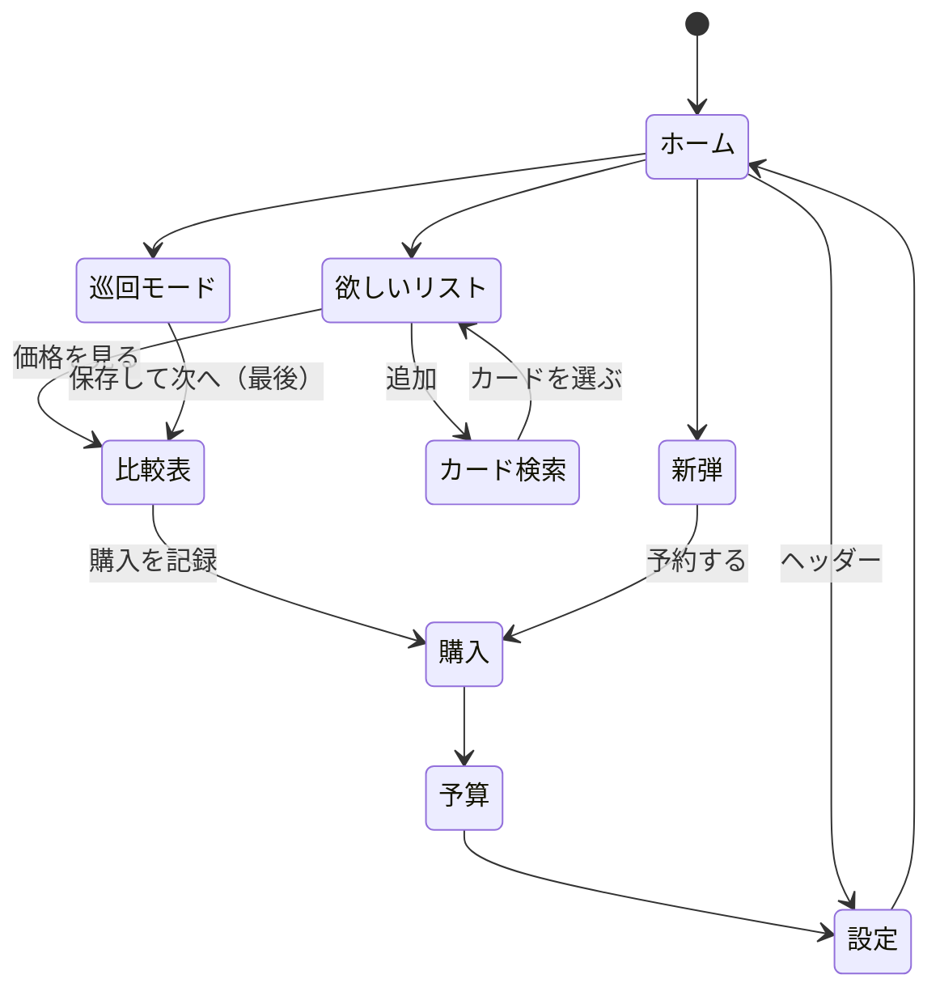
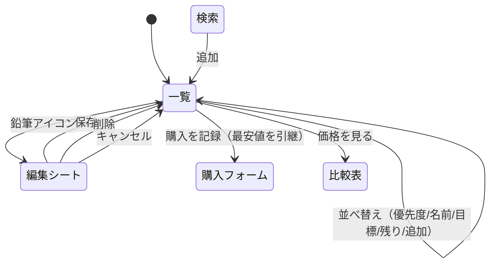
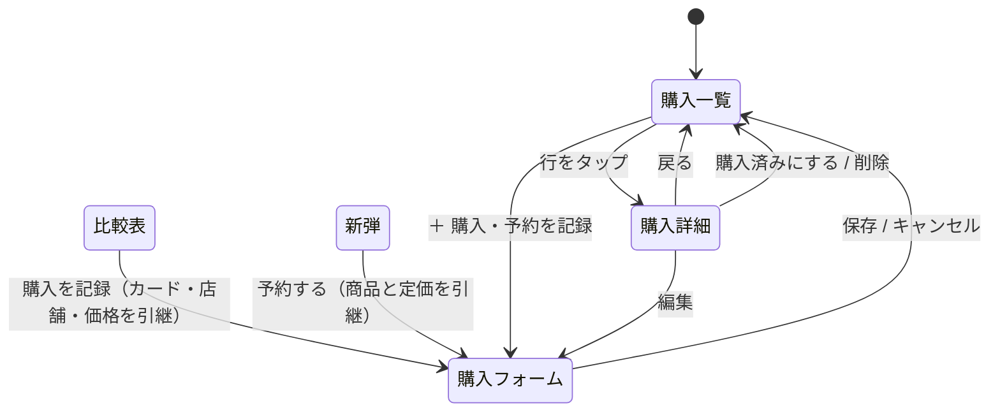

# 1. 画面遷移

**何を表す図か**: 9 画面の遷移。実線は MVP、破線は補助的な導線。



下部タブ: ホーム / 欲しい / 巡回 / 購入 / 予算。ヘッダー: 検索・全画面メニュー（モック専用）。

# 2. 各画面のワイヤー記述

## ① ホーム

```
[今月の残り                    内訳]
[¥820                         ]
[██████████████░░] ← 購入(緑) + 予約(黄) + 残り(灰)
[購入 ¥5,240 ＋ 予約 ¥5,940 / ¥12,000   93%]

[次の新弾          あと22日]
[QUARTER CENTURY CHRONICLE ...]
[2026/12/19（土）・1パック ¥198 / 1BOX ¥5,940]

[予約中 1 件]
[PRIDE AND SOUL  1BOX  ¥5,940  12/19 発売]

[欲しいリスト（優先度順）   すべて]
[● 灰流うらら   残り1枚 目標¥1,200]
[● 増殖するG    残り3枚 目標¥900 ]

[ ▶ 店舗を選んで巡回をはじめる ]
```

**狙い**: 「今いくら使えるか」「次に何を買うか」「予約を忘れていないか」が 1 画面で分かる。
**操作**: 残額→予算、新弾→新弾、予約→購入、欲しい行→比較、巡回→巡回。
**迷いどころ**: 予約中をホームに出すか（Q-13）。

## ② 欲しいリスト

**何を表す図か**: 欲しいリストの絞り込み・並べ替え・行アクション・編集シートの関係。



```
[欲しいもの                       ＋ 追加]
[種類 7 件   残り 9 枚   目標合計 ¥8,000]

[すべて 7][優先度 高][中][低][達成済み 1]
[並べ替え: 優先度順 ▼]

[高] 灰流うらら                    ✎
     レアリティ: 指定なし
     欲しい 2   購入済 1        残り 1 枚
     [████████░░]
     目標 ¥1,200  最安 ¥1,050（通販C）  目標より ¥150 安い
     [ 購入を記録 ][ 価格を見る ]
...
[達成済み 1 件を見る]
```

**狙い**: 「何が欲しいか」「あと何枚か」「今いくらで買えるか」を 1 行で判断できる。
**操作**: 絞り込み／並べ替え、行の鉛筆→編集シート、購入を記録→購入フォーム（最安店・価格を引継）、価格を見る→比較表、＋→検索。
**編集シート**: 優先度（高/中/低）、欲しい枚数（±）、目標単価、レアリティ（**選択式**）、メモ、削除／保存。レアリティは 指定なし / N / R / SR / UR / UL / SE / PSER / CR / HR / PR。期間限定（20th・ゴールド等）は出さない。
**迷いどころ**: レアリティを一覧に出すか（Q-11）、達成済みを自動で畳むか（R-13）。

## ③ カード検索

```
[🔍 うらら                          ✕]
[「うらら」の検索結果 3 件   手入力で登録]

[灰流うらら]
[  モンスター・チューナー / 効果      ＋ 追加 ]

[灰流うららの代替]
[  モンスター / 効果                 ＋ 追加 ]
```

**狙い**: 日本語名 → 1 タップで欲しいリストへ。型番選択を挟まない。
**操作**: 追加→（数量・優先度・目標価格のシート）→欲しいリスト。
**迷いどころ**: 追加シートを出すか、即追加して編集させるか。

## ④ 巡回モード

```
[いまいる店舗                最後に訪れた順]
[秋葉原A店][秋葉原B店][通販C][…]  [＋]
      ↑ チップのみ横スクロール    ↑ 固定

[並び順: 優先度順 | 種類→名前順]

[██████░░░░░░]  3 / 12

[灰流うらら]
[モンスター（チューナー・効果）]
[レアリティ（任意）: UR]   ← タップで選択
[目標 ¥1,200]

[価格                        ¥1,180]

[1][2][3]
[4][5][6]
[7][8][9]
[00][0][⌫]

[在庫なし][   保存して次へ   ]

[次の 3 件（種類→名前順）]
[増殖するG  モンスター]
[墓穴の指名者 魔法]
[無限泡影    罠]
```

**狙い**: 店頭で片手・10 秒以内。**並び順は店舗の陳列に合わせて切替**（優先度順＝買いたい順、種類→名前順＝ケースをたどる順）。店舗チップは最後に訪れた順で、右端の「＋」は常に押せる。
**操作**: 並び順チップ→リスト並び替え＆先頭へ、店舗チップ→対象店舗（訪問記録）、右端＋→新店舗追加、テンキー→保存して次へ。
**迷いどころ**: 既定をどちらにするか（Q-16）、グループ順が店舗と合うか（Q-17）、「訪れた」の更新タイミング（Q-18）。

## ⑤ 比較表（カード別 / 店舗別）

```
[カード別 | 店舗別]

カード別: カード名 → 店舗 → レアリティ
[灰流うらら        最安 ¥1,050（通販C / UR） [購入を記録]]
[  通販C       最安店   ¥1,050]
[    [UR] ¥1,050]
[  秋葉原A店            ¥1,180]
[    [UR] ¥1,180]
[  秋葉原B店            ¥1,280]
[    [UR] ¥1,280]
[  店舗間の差額 ¥230]

店舗別: 店舗 → カード名 → レアリティ
[カード通販 C          3 種]
[  灰流うらら   ¥1,050]
[    [UR] ¥1,050]
[  増殖するG    ¥890]
[    [SR] ¥890]
[  登録 3 種・最安の合計 ¥3,660]
```

**狙い**: 探し方に合わせて 2 軸を切替。「欲しいカードから安い店」と「回る店で買えるもの」を同じデータから見る。
**操作**: 切替→カード別/店舗別、購入を記録→購入フォーム（最安の店舗・レアリティ・価格を引継）。
**迷いどころ**: レアリティが違うものを同じ行で比べてよいか（カード単位の方針だが、最安のレアリティを明示する）。

## ⑥ 購入

**何を表す図か**: 購入まわりの画面遷移（一覧・フォーム・詳細・予約）。



```
[11月の購入        ＋ 購入・予約を記録]
[¥5,240  3件・予約中 ¥5,940（1件）]

[すべて 4][予約中 1][購入済 3]

[11/24 灰流うらら  単品/UR    ¥1,180]
[11/16 ブースター 1BOX（30パック）  ¥2,080]
[11/14 PRIDE AND SOUL 1BOX  予約中   ¥5,940]
[      2027/01/23 発売   [購入済みにする]]
```

## ⑥-a 購入フォーム

```
[記録する対象]
[ シングル | パック/BOX ]

シングル:
[カード名（検索/欲しいリストから）]
[ストレージ][灰流うらら][増殖するG][…]
※ シングルに予約はありません（予約トグルは出さない）

パック/BOX:
[商品名（選択式）        ▼]
  全商品（発売済みを含む）＋ 過去の購入履歴
[1パック ¥198 / 1BOX ¥5,940（30パック入り）]

[数量  パック|BOX 切替 ][ 3 ]  → 3BOX = 90パック（¥17,820）
  クイック選択: [1BOX][2BOX][3BOX][¥1,000以上: 6パック]
  遊戯王の日は対象商品 税込¥1,000 以上で参加（6パック = ¥1,188）
  切替で換算: BOX→パックは ×30、パック→BOX は端数切捨て（89 → 2BOX = 60）
[単価 ¥5,940][送料 ¥0]
[店舗 秋葉原A店]
[ ] 予約として記録する（発売 2027/01/23）
[合計 ¥5,940]   [キャンセル] [購入を保存]
```

**狙い**: パック/BOX は単位を選んで数量を入れるだけ。BOX なら数量×パック数を自動計算し、複数 BOX の購入が 1 操作で済む。商品名は選択式にして表記ゆれを防ぐ。
**操作**: 対象切替→商品選択→単位（パック/BOX）→数量→（必要なら予約）→保存。
**迷いどころ**: BOX 定価が無い商品（スペシャルパック等）の扱い、初期単位（Q-20）。

## ⑥-b 購入詳細

```
[購入済み/予約中] [単品・シングル]
灰流うらら
秋葉原A店 / UR

単価 ¥1,180
数量 1
送料 ¥0
購入日 11/24
合計 ¥1,180

[編集] [削除]
```

**狙い**: 記録の確認と修正。予約は「購入済みにする」を上部に出す。
**操作**: 編集→フォーム（値引継）、削除→一覧へ、予約→状態変更。

**迷いどころ**: 開封分の購入済み加算をどこから行うか（Q-14）。

## ⑦ 予算

```
[11月の予算                    変更]
[¥12,000 上限]
[████████████░░] ← 購入(緑) / 予約(黄) / 残り(灰)
[購入 ¥5,240][予約 ¥5,940][残り ¥820][1日 ¥205]

[カテゴリ別]
新弾      ¥2,080 / ¥3,000  [███░░]
シングル  ¥3,160 / ¥5,000  [████░]
グッズ    ¥0     / ¥2,500  [░░░░░]
その他    ¥0     / ¥1,500  [░░░░░]

[注意] 11月は残り4日。1日あたり ¥205 まで使えます（予約込み）。
```

**狙い**: 残額は「上限 − 購入 − 予約」。予約は別色で見せ、使い切った感を誤らないようにする。
**操作**: 変更→予算設定。
**迷いどころ**: カテゴリ内訳に予約を含めるか（Q-19）。

## ⑧ 新弾

```
[今後の新弾 3 件          手動で追加]

[12/19 土] QUARTER CENTURY CHRONICLE side:PRIDE
           1パック ¥198 / 1BOX ¥5,940（30パック入り）
           予約開始 11/14 ・ あと22日   [予約する]

[01/23 土] PRIDE AND SOUL
           1パック ¥198 / 1BOX ¥5,940（30パック入り）
           あと57日

[リマインダー]
[12/12 予約開始を確認] [12/19 発売]
```

**狙い**: 発売日・定価・パック数・予約開始が 1 行で分かる。
**操作**: 予約する→予約フォーム（店舗・数量・価格）、リマインダー完了。
**迷いどころ**: 発売済みの扱い、予約開始日が未発表の商品の表示。

## ⑨ 設定

```
[月次予算                 ¥10,000      ›]
[1BOXのパック数（既定）    30          ›]
[リマインダー              7日前       ›]
[カテゴリ配分             4 区分        ›]
[店舗                     3 件          ›]

[購入の既定値]
ストレージの初期価格   [30] 円
（シングルで「ストレージ」を選んだときの単価）

[データ]
最終エクスポート: 未実施
[エクスポート][インポート]
```

**狙い**: パック数の既定値を明示。データ保全の導線を常に見える位置に。
**操作**: 各行→該当画面。

# 3. S0 レビュー観点

1. **情報の優先順位**: ホームで最初に目に入るのが残額でよいか
2. **タップ領域**: 店舗チップ（36px）・レアリティ選択・並び順チップが小さすぎないか
3. **片手操作**: 下部タブと「保存して次へ」が親指で届くか
4. **数字の桁**: ¥10,000 / ¥5,940 / 30 パックで崩れないか
5. **用語**: 「型番」が出てこないか。「レアリティ」「予約」「定価」が自然か
6. **色**: 最安・警告・予約中の色が区別できるか

# 4. S0 レビューで決めたいこと

- Q-09: ホームの主役は残額か、欲しいリストか
- Q-10: 下部タブ 5 つで足りるか
- Q-11: レアリティを一覧のどこに出すか
- Q-12: 「在庫なし」を巡回モードに常設するか
- Q-16: 巡回モードの既定の並び順（優先度順 / 種類→名前順）
- Q-17: 種類順のグループ分け（モンスター→エクストラ→魔法→罠）が店舗の陳列と合うか
